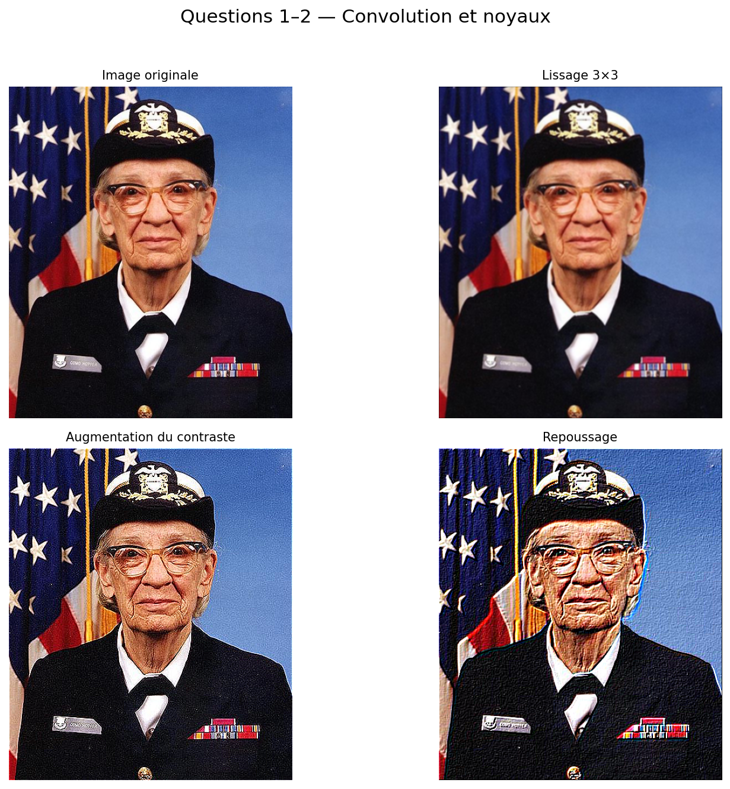
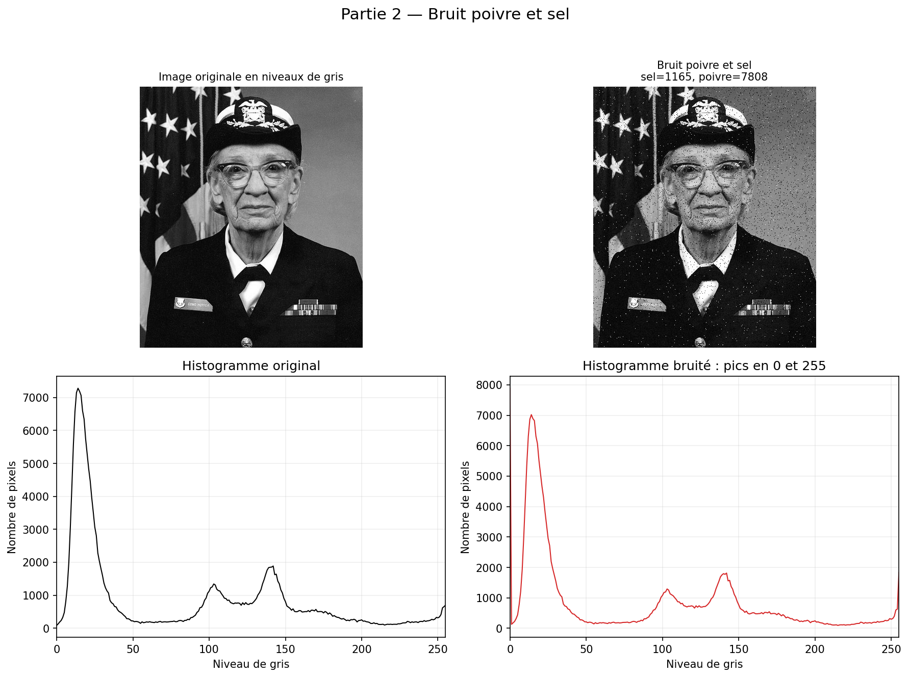
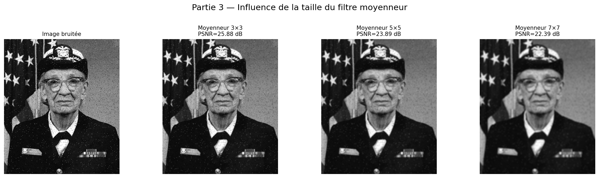
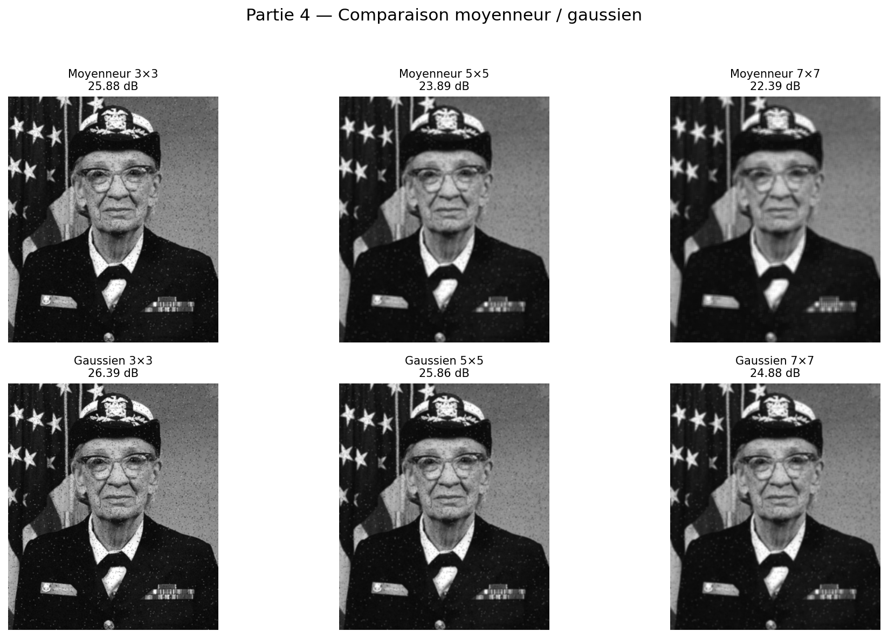
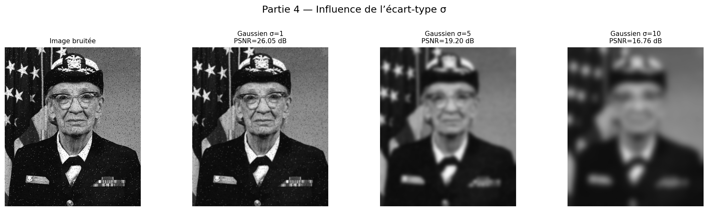
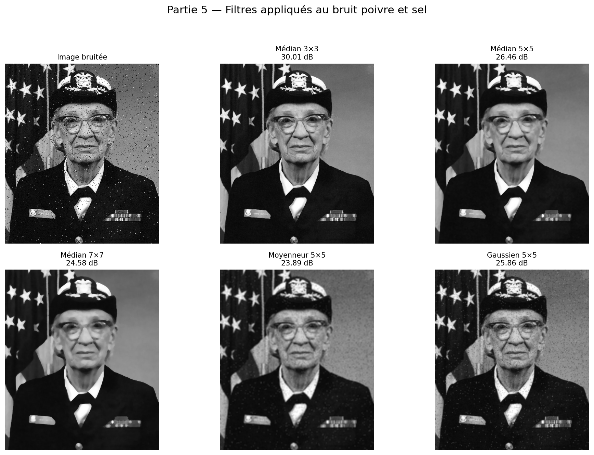
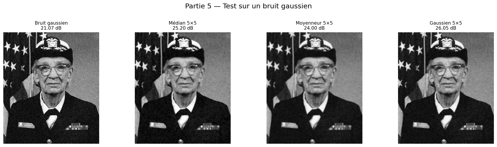

# TP n°2 — Filtrage d’images

**Module :** Vision Artificielle — EMSI Casa  
**Étudiant :** Anwar Ezzirani  
**Groupe :** G4  
**Année universitaire :** 2026–2027

## 1. Objectifs

Ce TP étudie les opérations de filtrage spatial utilisées en traitement d’images. Les objectifs sont :

- programmer une convolution avec padding ;
- appliquer des noyaux de lissage, de renforcement du contraste et de repoussage ;
- générer et analyser un bruit poivre et sel ;
- comparer les filtres moyenneur, gaussien et médian ;
- évaluer quantitativement les résultats avec le PSNR.

Le fichier `aero1.jpg` mentionné dans le sujet n’était pas fourni. La solution accepte automatiquement ce fichier s’il est ajouté ; pour produire le présent rapport, une image naturelle fournie avec Matplotlib a été utilisée.

## 2. Convolution d’une image

Pour chaque pixel, on superpose le noyau sur son voisinage, on multiplie les valeurs correspondantes puis on additionne les produits. Un padding nul est ajouté afin de conserver les dimensions. Chaque canal RGB est traité séparément et le résultat est saturé dans `[0, 255]`.

```python
def convolution(m, c):
    noyau = np.asarray(c, dtype=np.float64)
    if m.ndim == 2:
        m = m[..., np.newaxis]

    ry, rx = noyau.shape[0] // 2, noyau.shape[1] // 2
    image_pad = np.pad(m.astype(float), ((ry, ry), (rx, rx), (0, 0)))
    resultat = np.zeros_like(m, dtype=np.uint8)

    for i in range(m.shape[0]):
        for j in range(m.shape[1]):
            voisinage = image_pad[i:i+noyau.shape[0], j:j+noyau.shape[1]]
            somme = np.sum(voisinage * noyau[..., None], axis=(0, 1))
            resultat[i, j] = np.rint(somme).clip(0, 255)
    return resultat
```

## 3. Noyaux de filtrage

### Lissage

Le filtre moyenneur 3×3 remplace chaque pixel par la moyenne de son voisinage :

```python
C1 = np.ones((3, 3)) / 9
```

### Augmentation du contraste et de la netteté

Le noyau suivant renforce le pixel central et soustrait les quatre voisins directs :

```python
C2 = np.array([
    [ 0, -1,  0],
    [-1,  5, -1],
    [ 0, -1,  0]
])
```

### Repoussage

Les coefficients orientés négatifs et positifs produisent un effet de relief :

```python
C3 = np.array([
    [-2, -1, 0],
    [-1,  1, 1],
    [ 0,  1, 2]
])
```



## 4. Bruit poivre et sel

Le programme tire séparément entre 300 et 10 000 positions blanches et noires. Le bruit change lorsque la graine aléatoire change. Pour garantir la reproductibilité du rapport, la graine 42 a été utilisée : 1 165 pixels blancs et 7 808 pixels noirs ont été ajoutés.

```python
bruitee = ajouter_bruit_poivre_sel(
    gris, nombre_sel=1165, nombre_poivre=7808, seed=42
)
```

L’histogramme de l’image bruitée présente deux pics caractéristiques en 0 et 255.



## 5. Filtre moyenneur

Les noyaux 5×5 et 7×7 sont définis comme le noyau 3×3 :

```python
kernel_3x3 = np.ones((3, 3), np.float32) / 9
kernel_5x5 = np.ones((5, 5), np.float32) / 25
kernel_7x7 = np.ones((7, 7), np.float32) / 49
```

Avec OpenCV, les deux méthodes demandées sont :

```python
filtered_5x5 = cv2.filter2D(img, -1, kernel_5x5)
filtered_5x5 = cv2.blur(img, (5, 5))
```

Les deux méthodes produisent des résultats identiques pour ces noyaux. Plus le filtre est grand, plus le bruit diminue, mais plus l’image devient floue. Le filtre 3×3 obtient ici le meilleur PSNR des trois tailles.



## 6. Filtre gaussien

Contrairement au filtre moyenneur, le filtre gaussien donne un poids plus élevé aux pixels centraux. Les fenêtres 3×3, 5×5 et 7×7 ont été comparées avec les filtres moyenneurs correspondants.



Les valeurs de sigma 1, 5 et 10 ont également été testées. Un grand sigma provoque un lissage très important et supprime de nombreux détails. Pour cette expérience, `sigma = 1` offre le meilleur compromis.



## 7. Filtre médian

Le filtre médian remplace chaque pixel par la médiane du voisinage. Les valeurs extrêmes du bruit poivre et sel influencent peu la médiane, ce qui explique sa bonne efficacité.



Le filtre médian 3×3 atteint un PSNR de **30,01 dB**, supérieur au moyenneur 3×3 (**25,88 dB**) et au gaussien 3×3 (**26,39 dB**).

## 8. Test sur un bruit gaussien

Un bruit gaussien d’écart-type 25 a été ajouté à l’image. Le filtre médian améliore le résultat, mais le filtre gaussien est plus adapté à ce type de bruit :

- image bruitée : 21,07 dB ;
- médian 5×5 : 25,20 dB ;
- moyenneur 5×5 : 24,00 dB ;
- gaussien 5×5 : 26,05 dB.



## 9. Synthèse des mesures

| Traitement sur bruit poivre et sel | PSNR |
|---|---:|
| Image bruitée | 20,71 dB |
| Moyenneur 3×3 | 25,88 dB |
| Moyenneur 5×5 | 23,89 dB |
| Moyenneur 7×7 | 22,39 dB |
| Gaussien 3×3 | 26,39 dB |
| Gaussien 5×5 | 25,86 dB |
| Gaussien 7×7 | 24,88 dB |
| Médian 3×3 | **30,01 dB** |
| Médian 5×5 | 26,46 dB |
| Médian 7×7 | 24,58 dB |

Le PSNR est défini par :

`PSNR = 10 log10(255² / MSE)`

Une valeur plus élevée indique une image plus proche de l’originale.

## 10. Conclusion

La convolution permet de construire de nombreux traitements à partir d’un noyau. Le filtre moyenneur est simple, mais il floute les contours. Le filtre gaussien préserve mieux les structures grâce à sa pondération centrale et convient au bruit gaussien. Le filtre médian est le choix le plus efficace contre le bruit impulsionnel poivre et sel. Le choix de la taille du voisinage reste un compromis entre suppression du bruit et conservation des détails.
